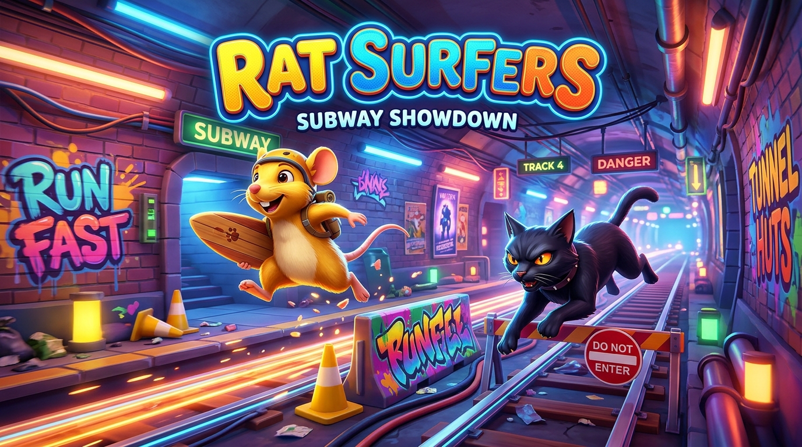

# 🧀 Rat Surfers: Subway Feline Escape



> A fast-paced 3D endless runner built with React, Three.js, and Vite. Help **Pip the nimble rodent** dash along subway tracks, dodge oncoming trains, leap over hurdles, and stay ahead of **Shadow the subway cat**!

---

## 🎮 Play Online
- **Live Game**: [ratsurfers.pages.dev](https://ratsurfers.pages.dev)
- **Installable PWA**: Works offline on Mobile (Android, iOS) & Desktop with 1-click home screen install.

---

## ✨ Features

- **Smooth 3D Subway Tracks**: 3-lane running with procedural track segments, candy land horizons, and dynamic biomes (Crystal Caverns, Cheese Grotto, Choco Chasm, Candy Mines).
- **Interactive Predator Chase**: Shadow the cat stalks behind you. Stumbling on hurdles brings him closer; maintain smooth runs to escape!
- **Collectibles & Currency**:
  - 🧀 **Swiss Cheese**: Main currency to unlock skins and gear in the Shop.
  - 🍬 **Peppermint Swirls**: Trade for bonus cheese rewards.
  - 🍫 **Chocolate Bars**: Rare high-value treats.
- **Power-Ups**:
  - 🧲 **Horseshoe Magnet**: Sucks in treats across all three lanes.
  - 🛡️ **Cheese Shield**: Absorbs a collision so you keep running.
  - 🚀 **Speed Cheddar Rocket**: Thruster sprint with invulnerability rush.
  - 🪽 **Glider Wings**: Soar high into the sky on aerial cheese runways.
- **Shop & Gear Upgrades**: Unlock skins (Classic Pip, Super Cheddar, Ninja, Cyberpunk, Royal King, etc.) and level up passive gadgets.
- **Dynamic Underground League**: Live virtual leaderboard that dynamically updates based on your run high scores.
- **Daily Escape Streaks**: Return every day to claim bonus rewards.

---

## 🕹️ Controls

| Action | Keyboard | Touch / Mobile |
| :--- | :--- | :--- |
| **Move Left** | `A` or `←` | Swipe Left / Tap Left Button |
| **Move Right** | `D` or `→` | Swipe Right / Tap Right Button |
| **Jump** | `W` or `↑` or `Space` | Swipe Up / Tap Jump Button |
| **Slide** | `S` or `↓` | Swipe Down / Tap Slide Button |
| **Pause** | `Escape` or `P` | Pause Button in HUD |

---

## 🛠️ Built With

- **[React 19](https://react.dev/)** – UI overlays, HUD, modals, shop, and state management.
- **[Three.js](https://threejs.org/)** – Real-time 3D rendering, procedural shaders, lighting, and camera physics.
- **[Vite 8](https://vitejs.dev/)** – Next-gen frontend tooling and lightning-fast builds.
- **[Tailwind CSS](https://tailwindcss.com/)** – Clean, modern HUD styling.
- **[vite-plugin-pwa](https://vite-pwa-org.netlify.app/)** – Service worker caching, offline support, and install prompts.

---

## 🚀 Running Locally

1. **Clone the repository**:
   ```bash
   git clone https://github.com/Ahileesh/Rat-Surfers.git
   cd Rat-Surfers
   ```

2. **Install dependencies**:
   ```bash
   npm install
   ```

3. **Start the dev server**:
   ```bash
   npm run dev
   ```
   Open [http://localhost:3000](http://localhost:3000) in your browser.

4. **Build for production**:
   ```bash
   npm run build
   ```
   The production-ready assets will be created in the `dist/` directory.

---

## 📄 License

This project is licensed under the [MIT License](./LICENSE). Feel free to play, fork, and build upon it!
